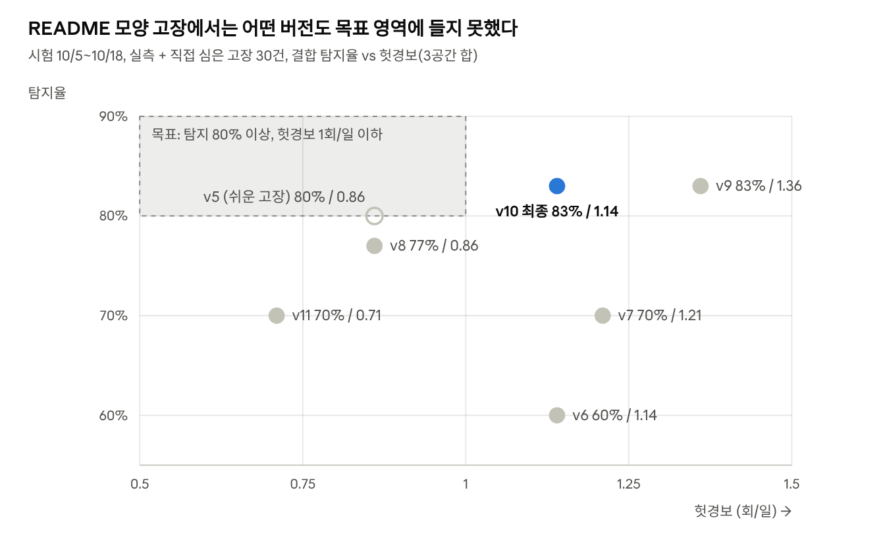
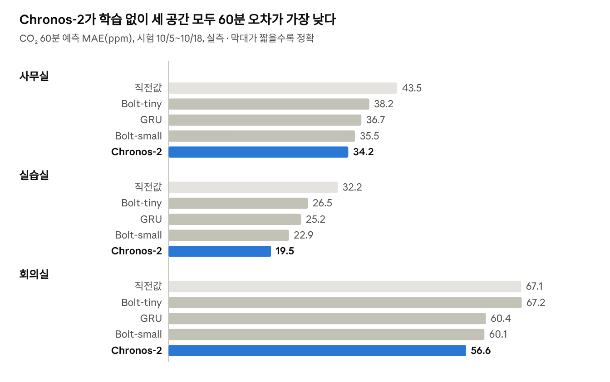
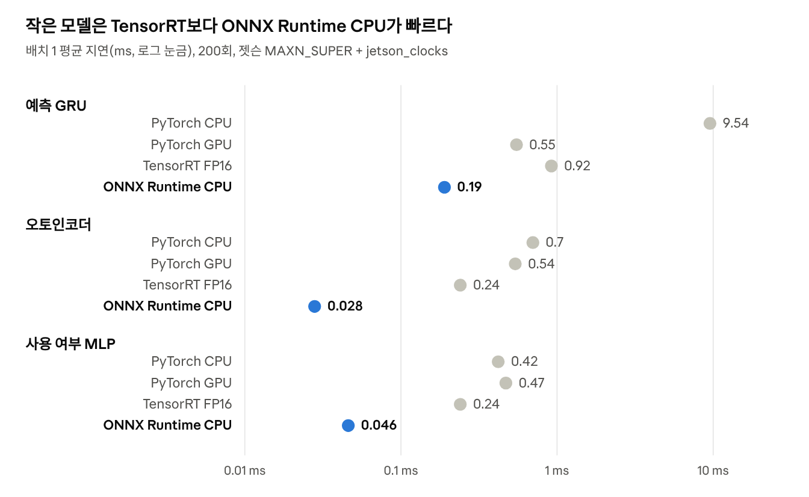
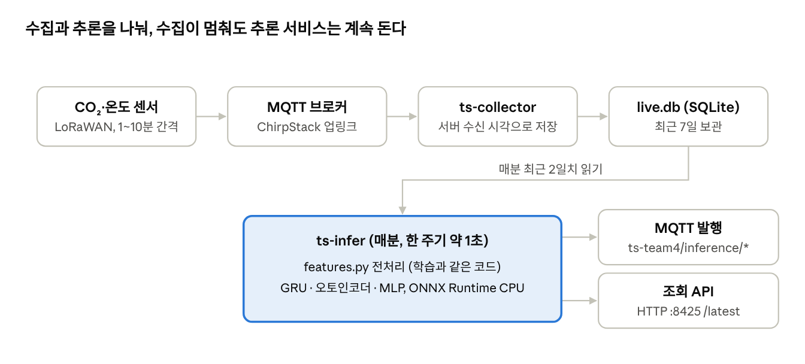

# 실내 환경 시계열 추론 — 최종 보고서 (이진행)

2026-10-22 · 이진행 (AIGJ_01_013)

## 요약

실습실·사무실·회의실 3곳의 12주 실측 CO₂·온도로 예측·이상 탐지·상태 추정 모델을 만들고, 젯슨 Orin Nano에서 매분 도는 상시 서비스로 17.8시간 무중단 가동했다. 가장 큰 발견은 **추가 학습 없는 Chronos-2가 직접 학습한 GRU보다 정확**했다는 것과, **9/21부터 세 공간 CO₂ 수준이 크게 낮아져** 학습 기간 패턴에 기댄 모델이 모두 흔들렸다는 것이다.

| 과제            | 확인 기준                               | 결과                                     | 판정        |
|-----------------|-----------------------------------------|------------------------------------------|-------------|
| 3\. 예측        | 60분 CO₂ 직전값 대비 30% 개선           | GRU 10~22%, Chronos-2 16~39%             | GRU 미달    |
| 3\. 예측        | 60분 온도가 직전값보다 좋음             | 4공간 모두 14~50% 개선                   | 충족        |
| 4\. 이상 탐지   | 탐지 80% 이상, 헛경보 1회/일 이하       | 83%, 1.14회/일 (README 고장 모양)        | 탐지만 충족 |
| 5\. 사용 여부   | 규칙보다 좋음                           | MLP F1 67.2 vs 규칙 49.9                 | 충족        |
| 5\. 환기 경보   | 재현율 85% 이상, 규칙보다 macro-F1 높음 | GRU 예측 방식 89.6%, 61.0 vs 60.9        | 충족(근소)  |
| 6\. 사전학습    | GRU와 비교, 구간 적중 80% 근처          | Chronos-2가 3공간 모두 우세, 적중 76~78% | 채택        |
| 7\. 엣지 변환   | CO₂ 차이 1ppm 이하, 판정 변화 0.1% 이하 | 최대 0.21ppm, 판정 변화 0건              | 충족        |
| 8\. 상시 서비스 | 12시간 무중단, 수집 장애 처리           | 17.8시간 실패 0회, 수집기 정지 감지·해제 | 충족        |

**공통 측정 조건** (각 표에는 다른 점만 적음)

| 항목        | 내용                                                                                        |
|-------------|---------------------------------------------------------------------------------------------|
| 데이터      | 실측 12주(2026-07-27~10-18), InfluxDB에서 받은 원본, 5분 간격으로 정제                      |
| 분할        | 학습 7/27~9/20(8주), 검증 9/21~10/4(2주), 시험 10/5~10/18(2주), 시간순                      |
| 평가        | 과제 2에서 저장한 같은 평가 시점(eval_points.csv), 시험 기간은 마지막 한 번만               |
| 합성 데이터 | 과제 4의 고장만 직접 주입(실측 위에 덧씌움), 과제 5의 정답은 CO₂ 흐름에서 만든 대체 정답    |
| 보드        | Jetson Orin Nano Super 8GB, JetPack 7.2, 전력 모드 MAXN_SUPER (과제 7은 jetson_clocks 적용) |

조회 API: http://100.105.144.42:8425/latest (공간별 /latest/office, /lab, /meeting), MQTT ts-team4/inference/# (100.105.144.42는 Tailscale 주소. 같은 교내망에서는 172.27.110.134:8425로도 접속되며, 이 주소는 다시 연결하면 바뀔 수 있음).

## 과제 2. 정제와 기준선

기준선 중 **직전값 유지가 모든 거리·공간에서 가장 정확**해, 이후 모든 모델의 비교 기준으로 썼다.

정제 규칙 (학습과 상시 서비스가 같은 코드 features.py 사용)

1.  불가능한 값 제거: CO₂ 350~5,000ppm, 온도 0~45℃, 습도 0~100% 밖은 결측.

2.  튀 값 제거: 앞뒤 값 둘 다와 같은 방향으로 300ppm(온도 3℃) 넘게 다르면 결측.

3.  중복 제거: 같은 센서·5초 이내·같은 값은 하나만.

4.  5분 평균. 10분 간격 센서(회의실, 실습실 1대)는 센서 단위로 앞 값 1칸을 채운 뒤 합침.

5.  15분 이하 결측만 직선 보간, 그보다 길면 결측 유지.

6.  센서 여럿(실습실 CO₂ 4대): 평소엔 평균, 하나가 150ppm 넘게 튀면 가운데 두 값 평균.

7.  테스트 장치(dev001/lab) 제외, 시각은 한국 시간으로 변환.

온도 정제 결과: 원본 980,893건 중 중복 60,238건 제거, 범위 밖·튀 값 0건.

**기준선 오차** (시험 10/5~10/18, CO₂ MAE ppm, 실측)

| 공간   | 기준선          | 5분   | 15분  | 30분  | 60분  |
|--------|-----------------|-------|-------|-------|-------|
| 사무실 | 직전값          | 9.3   | 16.4  | 25.6  | 43.5  |
| 사무실 | 최근 1시간 평균 | 24.9  | 31.2  | 40.3  | 57.9  |
| 사무실 | 어제 같은 시각  | 130.9 | 131.0 | 131.1 | 131.3 |
| 실습실 | 직전값          | 5.1   | 10.2  | 18.0  | 32.2  |
| 실습실 | 최근 1시간 평균 | 18.1  | 23.0  | 29.9  | 42.5  |
| 실습실 | 어제 같은 시각  | 85.9  | 85.9  | 86.0  | 86.1  |
| 회의실 | 직전값          | 11.6  | 28.0  | 42.2  | 67.1  |
| 회의실 | 최근 1시간 평균 | 39.4  | 48.7  | 61.4  | 84.7  |
| 회의실 | 어제 같은 시각  | 188.7 | 188.7 | 188.7 | 189.0 |

**해석.** 실내 CO₂는 1시간 안에서는 천천히 변해 직전값이 강한 기준이 된다. "어제 같은 시각"이 가장 나쁜 것은 요일·수업 유무에 따라 하루가 크게 달라서다. 따라서 모델은 직전값을 얼마나 이기는지로만 평가했고, 60분 거리가 개선 여지가 가장 크다.

## 과제 3. GRU 예측

GRU는 60분 CO₂ 오차를 직전값보다 **10~22% 줄였지만 목표 30%에는 못 미쳤다.** 온도는 모든 공간에서 직전값을 넘었다.

모델: GRU, 입력 지난 2시간(24칸)의 "지금 값 대비 차이" + 시각(sin·cos) + 쉬는 날 + 공간, 출력 앞으로 60분(12칸)의 변화량(50ppm 단위). 학습+검증(7/27~10/4)으로 3 epoch 재학습 후 시험 1회 평가.

**거리별 오차** (시험 10/5~10/18, CO₂ MAE ppm, 직전값 → GRU, 괄호는 개선%, 실측)

| 공간   | 5분               | 15분             | 30분              | 60분              |
|--------|-------------------|------------------|-------------------|-------------------|
| 사무실 | 9.3 → 9.1 (+2)    | 16.5 → 15.1 (+9) | 25.6 → 22.9 (+11) | 43.5 → 36.7 (+16) |
| 실습실 | 5.1 → 4.4 (+14)   | 10.2 → 8.0 (+22) | 18.0 → 14.7 (+18) | 32.2 → 25.2 (+22) |
| 회의실 | 11.5 → 13.0 (−13) | 27.9 → 25.4 (+9) | 42.1 → 38.3 (+9)  | 67.1 → 60.4 (+10) |

**일정을 넣으면?** (시험 60분 CO₂ MAE ppm, 일정 데이터가 없어 두 가지로 가정)

| 공간   | 직전값 | 일정 없음 | 고정 시간표(평일 9~12·13~18시) | 실제 사용 복원(상한) |
|--------|--------|-----------|--------------------------------|----------------------|
| 사무실 | 43.5   | 36.7      | 39.4                           | 28.5 (+34.5%)        |
| 실습실 | 32.2   | 25.2      | 23.2                           | 23.4 (+27.3%)        |
| 회의실 | 67.1   | 60.4      | 61.8                           | 45.5 (+32.2%)        |

"실제 사용 복원"은 미래 CO₂로 만든 일정이라 운영에는 못 쓰고, 정확한 예약 기록이 있을 때의 상한을 보여 준다.

**온도 60분** (시험 MAE ℃, 직전값 → GRU): 사무실 0.07 → 0.06, 실습실 0.14 → 0.11, 회의실 0.17 → 0.14, 사무실 밖 0.32 → 0.16.

**해석.**

- **왜 30%에 못 미쳤나:** 학습 기간(고농도)과 검증·시험 기간(9/21 이후 저농도)의 사용 패턴이 달라 1~3 epoch에서 바로 과적합했다. 입력을 절대값에서 "지금 값 대비 차이"로 바꾸자 실습실 검증 개선이 −18%에서 0%로 회복됐다.

- **그래서:** 사람이 들어오는 시점은 과거 CO₂만으로 알 수 없다. 정확한 예약·시간표가 있으면 회의실·사무실에서 오차가 8~15ppm 더 줄어 30%를 넘는다. 학교 시간표를 받는 것이 모델 개선보다 효과가 크다.

- **회의실 5분이 나쁜 이유(추정):** 10분 간격 센서를 앞 값으로 채워 5분 변화의 절반이 0이라 직전값이 유리하다.

- **온도:** 실내는 1시간에 0.1℃ 수준으로만 변해 오차가 애초에 작다. 하루 주기가 뚜렷한 바깥(사무실 밖)에서 GRU 효과가 50%로 가장 크다.

## 과제 4. 이상 탐지

README 모양의 고장에서 최종안(v10)은 **탐지 83%, 헛경보 하루 1.14회**로, 탐지 기준은 넘고 헛경보 기준(1회)은 0.14회 넘었다. 이 데이터에서는 "탐지 80% 근처에서 헛경보 1.1~1.2회/일"이 한계선이다.

평가 방식 (가정): 키트의 "고장 정답 주"가 없어 시험 기간 실측 위에 고장 5종 × 공간 3곳 × 2번 = 30건을 직접 심었다. 검증 기간에도 같은 방식으로 3벌(90건)을 심어 임계값을 골랐고, 시험 기간은 평가에만 썼다. 고장 진행 중 울린 경보만 탐지로 인정했고, 30분 안에 이어지는 경보는 한 건으로 셈다.

| 고장        | 심은 모양 (README)                      |
|-------------|-----------------------------------------|
| 튀 값       | CO₂ 한 칸 +800ppm                       |
| 값 고정     | CO₂ 3시간 같은 값                       |
| 영점 틀어짐 | 6시간에 걸쳐 300~500ppm 서서히          |
| 냉방 정지   | 수업 중 4시간 동안 온도 +3~5℃           |
| 환기 정지   | 사용 중(CO₂ 오르는 3시간) 상승 폭 1.8배 |

탐지기: 규칙(급변, 값 고정, 범위 밖, 평일 낮 온도 상승, 계단) + 오토인코더(1시간 창) + 예측 잔차(30분·1시간·3시간) + 바닥값 + 공간 간 차이. 탐지기마다 임계값을 따로 골랐고(탐욕 선택), "15분 이상 계속 넘을 때만" 버전도 후보로 넣었다.

고장 종류별 결과 (시험 10/5~10/18, v10 결합, 실측 위에 심은 합성 고장 30건)

| 고장        | 탐지 / 건수   | 평균 탐지 지연(분) |
|-------------|---------------|--------------------|
| 튀 값       | 6 / 6         | 0                  |
| 냉방 정지   | 6 / 6         | 45                 |
| 값 고정     | 6 / 6         | 54                 |
| 환기 정지   | 4 / 6         | 24                 |
| 영점 틀어짐 | 3 / 6         | 307                |
| 합계        | 25 / 30 (83%) | 원인 센서 맞음 88% |

방식별 성적표 (같은 조건)

| 방식             | 탐지율 % | 헛경보 / 일 (3공간 합) |
|------------------|----------|------------------------|
| 모델(오토인코더) | 33       | 0.57                   |
| 규칙 전체        | 70       | 0.71                   |
| 결합             | 83       | 1.14                   |

헛경보 한도별 결합 성적 (한도는 검증 기간에서만 적용, 시험은 결과만 봄)

| 검증 헛경보 한도 / 일 | 검증 탐지 % | 검증 헛경보 / 일 | 시험 탐지 % | 시험 헛경보 / 일 | 탐지기 수 |
|-----------------------|-------------|------------------|-------------|------------------|-----------|
| 0.50                  | 77          | 0.26             | 73          | 0.64             | 6         |
| 0.75                  | 83          | 0.69             | 83          | 1.14             | 7         |
| 1.00 ~ 2.00           | 83          | 0.69             | 83          | 1.14             | 7         |

- 모델이 못 잡는 종류: 오토인코더는 1시간 창이라 영점 틀어짐·냉방 정지처럼 몇 시간에 걸쳐 진행되는 고장을 정상으로 본다. 단독 33%는 대부분 튀 값이다.

- 규칙이 못 잡는 종류: 영점 틀어짐은 한 번에 크게 변하지 않아 급변·값 고정 규칙에 안 걸린다. 잡은 3건도 평균 307분, 즉 6시간 중 거의 끝에서야 잡았다.

- 한도를 0.75보다 느슨하게 해도 더 들어오는 탐지기가 없어 성적이 같다. 반대로 0.5로 조이면 시험 헛경보는 0.64회로 기준을 넘지만 탐지가 73%로 떨어진다. 두 기준 사이의 교환이 표에서 보인다.

과제4_결과기록 · 버전별 시험 결합 성적, v5만 쉬운 고장 모양

**해석.**

- **v5의 80%/0.86회는 고장이 쉬운 모양이라 나온 값이다.** 영점을 한 번에 +200ppm 옮기는 대신 README대로 6시간에 걸쳐 옮기자 같은 방법이 60%로 떨어졌다(v6).

- **영점 틀어짐을 가장 잘 잡은 건 공간 간 차이였다.** 한 공간만 서서히 올라가면 다른 공간과의 차이가 벌어진다. 검증에서 18건 중 10건을 헛경보 0.19회/일로 잡았다.

- **환기 정지는 CO₂만으로는 근본적으로 어렵다.** 들어오는 사람 수가 매번 달라 상승 폭이 1.8배여도 평소 범위 안에 든다. HVAC 상태(MQTT xflow/hvacr)와 결합해야 한다.

- **검증 헛경보가 냙관적으로 추정됐다.** v10은 검증 0.69회가 시험 1.14회가 됐다. 임계값을 만든 기간에서 헛경보를 세서다. 이를 고친 v11(앞주↔뒷주 교차)은 70%/0.71회로 보수적이 됐다.

- **그래서:** 운영에서는 헛경보 한도를 하루 1.2회로 합의하거나, 실습실 센서 4대끼리 비교·HVAC 신호를 더해야 두 기준을 동시에 넘을 수 있다. 시험 기간을 보고 임계값을 고르면 넘길 수 있지만 누수라 하지 않았다.

## 과제 5. 상태 추정

사용 여부는 **MLP가 규칙보다 F1 17점 높았고**, 환기 선제 경보는 분류기 대신 **과제 3 GRU 예측을 그대로 쓴 방식**만 두 기준을 모두 넘었다(규칙과의 차이는 근소).

정답 (가정): 실제 시간표·관찰 기록이 없어, CO₂ 흐름을 앞뒤 30분 보고 "오르는 중(30분 +20ppm 초과)이거나 그날 바닥보다 250ppm 넘게 유지"를 사용 중으로 봤다. 환기 경보 양성은 "지금 1,000ppm 미만이고 30분 안에 1,000 이상"이다.

**사용 여부** (시험 10/5~10/18, 대체 정답 기준, %)

| 방법              | 정확도 | 재현율 | 정밀도 | F1       | macro-F1 | 빈방→사용 오류율 |
|-------------------|--------|--------|--------|----------|----------|------------------|
| 규칙(15분 +30ppm) | 86.5   | 34.4   | 90.7   | 49.9     | 71.0     | **0.9**          |
| 로지스틱 회귀     | 88.8   | 56.1   | 80.9   | 66.2     | 79.7     | 3.2              |
| MLP               | 88.6   | 59.7   | 77.0   | **67.2** | **80.2** | 4.3              |

**환기 선제 경보** (시험, 양성 135건 / 11,029, %)

| 방법                       | 재현율   | 정밀도   | macro-F1 | 헛경보/일(3공간) |
|----------------------------|----------|----------|----------|------------------|
| 규칙(지금 850ppm 이상)     | 82.2     | 14.7     | 60.9     | 45.9             |
| MLP 분류기                 | 89.6     | 10.0     | 56.3     | —                |
| GRU 예측 30분 최대 ≥ 860   | **89.6** | 14.8     | **61.0** | 49.9             |
| GRU 예측 30분 최대 ≥ 1,000 | 29.6     | **71.4** | 70.7     | **1.1**          |

기준 860은 검증 기간에서 재현율 85%가 되는 값으로 골랐다.

**해석.**

- **사용 여부:** MLP는 규칙이 놓치는 "천천히 오르는 사용"을 잡아 재현율이 25%p 높다. 대신 빈방을 사용 중으로 보는 일이 4.3%로 늘어, 냉난방 자동 제어처럼 헛동작이 비싼 곳에는 규칙이 안전하다. 가장 많이 틀리는 곳은 실습실 수업 시간이다. 넓은 방에 센서 4대 평균이고 9/21 이후 인원이 줄어 상승이 작다(추정).

- **환기 경보:** 분류기는 학습 기간(양성 3%)의 가파른 상승을 기억해 시험(양성 1.2%)에서 과하게 울렸다. GRU는 "지금 값 + 예측 변화량"으로 판단해 낮아진 수준을 자연히 반영한다.

- **그래서:** 상시 서비스는 두 단계 경보를 쓴다. 30분 내 예측 최대가 1,000 이상이면 "환기 필요"(10번 중 7번 맞음, 하루 1회), 860~1,000이면 "주의"(조기, 놓침 적음)다.

## 과제 6. 사전학습 모델

**Chronos-2는 추가 학습 없이 세 공간 모두 직접 학습한 GRU보다 정확했다.** 실습실 60분 오차는 25.2 → 19.5ppm으로, 직전값 대비 39% 개선이다.

조건: 공간별 CO₂ 지난 7일(5분 × 2,016칸, 절대값) → 앞으로 60분, 분위수 10·50·90% 출력(점 예측 = 50%). 과제 2와 같은 시험 평가 시점. 젯슨 GPU, float32, MAXN_SUPER.

과제3_결과기록·과제6_결과기록 · 시험 기간 60분 MAE, 공간 3곳 × 모델 5개

**예측 구간과 보드 비용** (시험, 구간 = 10~90%, 지연 = 시계열 1개 1회, 워밍업 5회 후 50회 평균)

| 모델               | 파라미터 | 60분 구간 적중률 % | 60분 구간 폭 ppm (사무실/실습실/회의실) | 지연 ms | GPU 메모리 MB |
|--------------------|----------|--------------------|-----------------------------------------|---------|---------------|
| Chronos-2          | 119.5M   | 76~78              | 90 / 49 / 145                           | 77.7    | 781           |
| Chronos-Bolt small | 47.7M    | 76~81              | 99 / 66 / 161                           | 49.3    | 448           |
| Chronos-Bolt tiny  | 8.7M     | 74~81              | 106 / 68 / 200                          | 36.6    | 140           |

**해석.**

- **왜 GRU를 이겼나(추정):** Chronos는 7일을 보고 하루·주 단위 반복을 직접 읽고, 절대 수준을 매번 입력에서 다시 맞춘다. 그래서 9/21 이후 수준 변화에 흔들리지 않는다. GRU는 지난 2시간만 보고, 바뀐 패턴을 다시 배우려면 재학습이 필요하다.

- **구간:** 세 모델 모두 목표 80% 근처로 약간 좁게 잡는다. Chronos-2는 적중률이 2~3%p 낮지만 구간이 가장 좁아 실제로 가장 쓸모 있다.

- **그래서:** 정확도로는 Chronos-2를 채택한다. 단 8GB 보드를 로컬 LLM과 나눠 써야 해 메모리 여유가 1GB 미만이면 Bolt-small(448MB)이 현실적이다. 상시 서비스 v1은 메모리가 수 MB인 GRU로 먼저 가동했고, Chronos-2 교체는 다음 단계다. Bolt-tiny는 회의실에서 직전값과 같아 쓸 이유가 없다.

## 과제 7. 엣지 최적화

ONNX·TensorRT로 바꿔도 결과는 사실상 같았고(FP16 CO₂ 차이 최대 0.21ppm), **이 작은 모델들에서는 TensorRT가 아니라 ONNX Runtime CPU가 가장 빨랐다.**

조건: jetson_clocks 적용(CPU 1.728GHz 고정), torch 2.14.1+cu132, onnxruntime 1.31.0(CPU), TensorRT 10.16.2.10, ONNX opset 17. 워밍업 20회 제외 200회 평균. GPU 방식은 입력이 이미 GPU에 있는 상태, ONNX Runtime은 복사 포함. 차이는 PyTorch GPU(FP32) 기준, 시험 기간 입력 약 1.2만 개.

과제7_결과기록 · edge/latency.csv, 배치 1 평균, 모델 3개 × 방식 4개

**변환 전후 차이** (모두 기준 통과)

| 모델 (파라미터)          | 방식                                | 차이                                    | 기준   |
|--------------------------|-------------------------------------|-----------------------------------------|--------|
| 예측 GRU (약 4.2만)      | ONNX Runtime / TensorRT FP16 / FP32 | CO₂ 최대 0.001 / 0.212 / 0.069ppm       | ≤ 1ppm |
| 오토인코더 (약 3,700)    | 전 방식                             | 경보 판정 바뀜 0% (점수 최대 차이 8e-4) | ≤ 0.1% |
| 사용 여부 MLP (약 1,500) | ONNX·TensorRT FP16 / FP32           | 판정 바뀜 0건 / 1건 (12,082개 중)       | ≤ 0.1% |

보드 상태(측정 전체, tegrastats): RAM 최대 6,280MB, GPU 사용률 최대 62%, 보드 전력 평균 8.2W / 최대 11.2W. TensorRT 엔진 생성은 모델당 4~13초.

**해석.**

- **왜 TensorRT가 빠르지 않나:** 계산 자체는 수 µs인데, GPU에 일을 넘기는 고정 비용(약 0.2~0.5ms)이 지연을 결정한다. 같은 이유로 FP16이 FP32보다 빠르지 않고, 배치 4도 배치 1과 거의 같은 시간이다.

- **GRU에서 TensorRT가 PyTorch GPU보다 느린 이유(추정):** TensorRT는 24칸을 차례로 도는 반복 구조로 나눠 실행하고, PyTorch는 cuDNN GRU 커널 하나로 처리한다.

- **그래서:** 상시 서비스는 세 모델을 ONNX Runtime CPU로 돌려 GPU를 비워 두고, GPU는 Chronos-2(78ms)·로컬 LLM처럼 큰 모델에 쓴다. TensorRT 변환이 의미 있는 대상은 Chronos-2 같은 큰 모델이다.

## 과제 8. 상시 추론 서비스

젯슨에서 **17.8시간 동안 1,068주기를 실패 없이** 돌렸고, 수집기를 10분 멈춘 장애를 다음 주기에 감지했다. 지금도 가동 중이다.

상시 서비스 구성 · systemd 서비스 2개, 죽으면 5초 뒤 자동 재시작

- 입력은 마지막으로 다 찬 5분 칸까지만 쓴다. 전처리는 학습과 같은 코드(features.py)를 import해 쓰며, 가짜 데이터로 학습용 정제 결과와 차이 0을 확인했다.

- 매분 발행하는 것: 5~60분 CO₂ 예측, 1,000ppm까지 남은 시간, 환기 단계, 이상 여부와 원인 센서, 사용 여부 확률, 켜져 있는 경보. 결과마다 계산 시각·데이터 시각·모델 버전을 넣었다. 필드와 단위는 별도 문서 "과제8_결과형식.md"에 있다.

- 조회: http://100.105.144.42:8425/latest, /latest/office·/lab·/meeting, /alarms, /health. MQTT ts-team4/inference/room/\*(retained), /status(서비스가 죽으면 LWT로 alive:false), /alarm.

- 경보 중복 억제: 발생 1번, 계속되면 60분마다 1번, 15분 동안 다시 안 걸려야 해제 1번.

**가동 기록** (2026-10-21 14:56 ~ 10-22 08:42 KST, 실측 센서 실시간, MAXN_SUPER)

| 항목             | 결과                                                                                 |
|------------------|--------------------------------------------------------------------------------------|
| 주기 / 실패      | 1,068회 / 0회                                                                        |
| 서비스 중단      | 없음                                                                                 |
| 처리 시간        | 평균 985ms, p95 1,207ms, 최대 1,268ms (1분 주기의 약 2%)                             |
| 수집기 정지 시험 | 마지막 수신 16:36 → 16:40 "수집 끊김" 발생 → 17:03 해제. 그동안 추론 실패 0회        |
| 경보             | 환기 2회(사무실 16:50 1,027ppm, 17:45 예측 1,007ppm), 수집 끊김 1회, 이상 헛경보 0회 |

**실제 데이터에서 발견하고 고친 것.**

- 게이트웨이 1대의 시계가 약 5분 빨라 메시지의 time이 틀렸다. 네트워크 서버 수신 시각(nsTime)으로 바꿨다. 그대로 두었다면 값이 엉뚱한 5분 칸에 들어갔다.

- 가짜 데이터 연속 시험에서 경보가 켜졌다 꺼졌다를 반복했다. 해제에 15분 유예를 두어 3시간 경보 이벤트가 38건에서 20건으로 줄었다.

- 회의실 센서는 10분 간격이라 시작 직후 "데이터 끊김"이 났다가 풀렸다. 끊김 기준을 20분으로 둔 이유다.

**그래서:** 처리 시간 대부분은 2일치 전처리다(모델 실행은 ms 단위). 여유가 충분해 Chronos-2(78ms)를 넣어도 주기를 지킬 수 있다.

## 가장 의외였던 발견과 한계

**가장 의외였던 발견: 9/21부터 세 공간의 CO₂가 한꺼번에 낮아졌고, 이 한 번의 변화가 거의 모든 결과를 설명한다.** 실습실 평일 낮 CO₂는 1,200~2,000ppm에서 600~900ppm으로 떨어졌다. 학습 기간이 바로 그 전에 끝나서, 학습 패턴을 기억하는 모델은 모두 흔들렸다.

- GRU는 1~3 epoch에서 과적합했고 60분 30% 목표에 못 미쳤다.

- 환기 분류기는 가파른 상승을 기억해 시험에서 과하게 울렸다.

- 이상 탐지의 검증 헛경보가 시험보다 낮게 추정됐다.

- 반대로 매번 7일치를 보고 수준을 다시 맞추는 Chronos-2는 학습 없이 가장 정확했다.

두 번째로 의외였던 것은 작은 모델에서 TensorRT가 CPU보다 느렸다는 점이다. "GPU 변환 = 빠름"은 모델이 충분히 클 때만 맞다.

**한계.**

- 고장 정답·시간표·관찰 기록이 없어, 과제 4는 직접 심은 고장으로, 과제 5는 CO₂에서 만든 대체 정답으로 평가했다. 실제 고장·사용에서의 성능은 다를 수 있다.

- 상시 가동 중에는 실제 고장이 없어 이상 탐지율을 확인하지 못했다. 헛경보 0회만 확인했다.

- 서비스를 재시작하면 켜져 있던 경보를 잊어 같은 경보를 다시 "발생"으로 보낸다. 경보 상태를 파일에 저장하면 해결된다.
